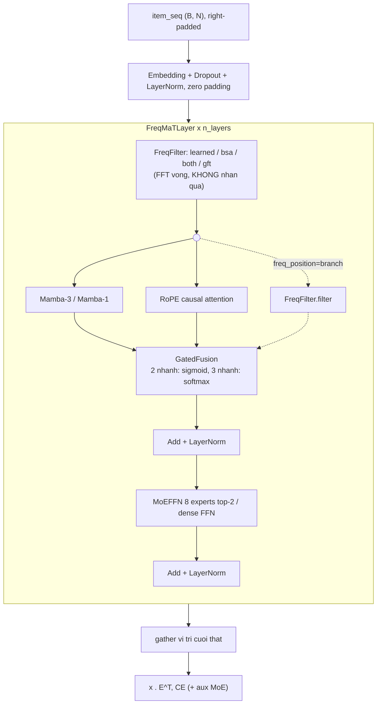
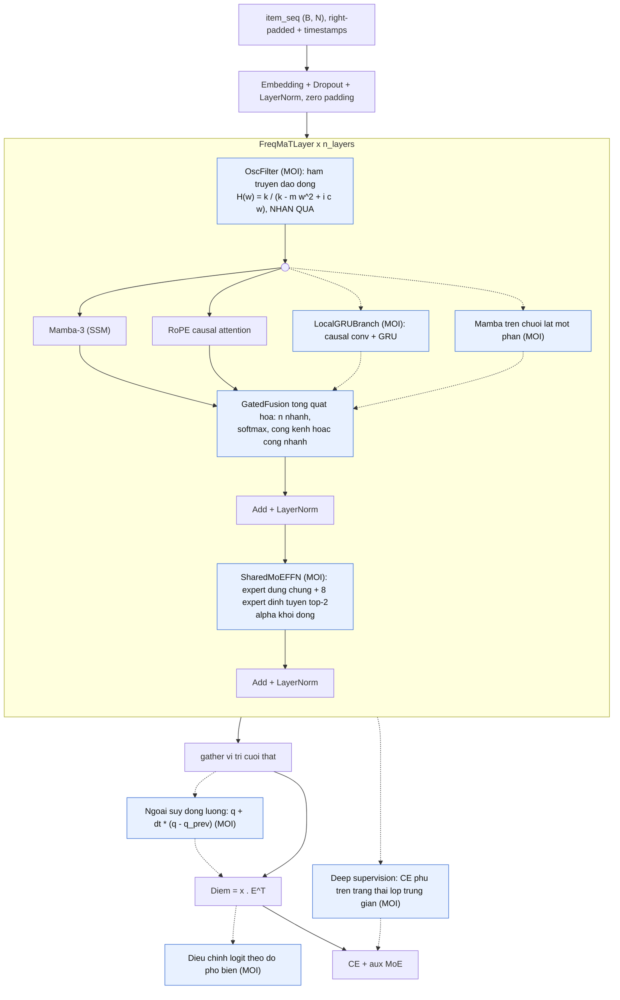
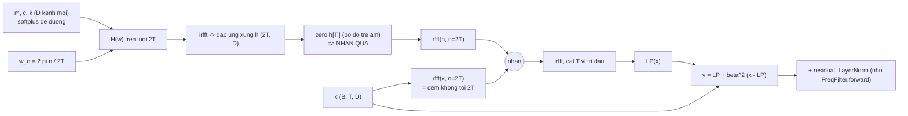
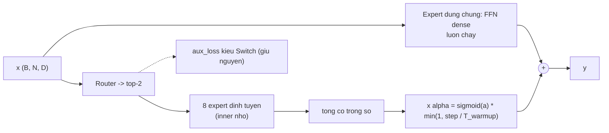
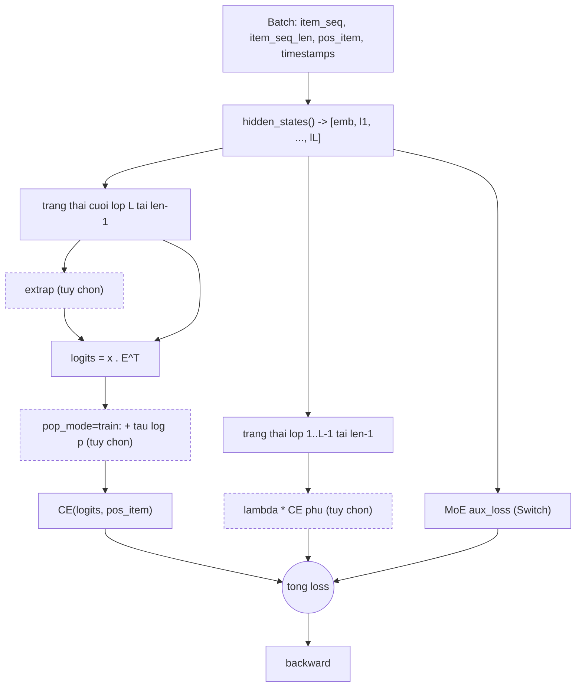
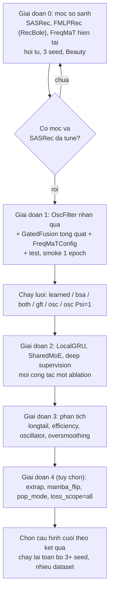

# Hướng dẫn thiết kế lại kiến trúc FreqMaT

Tài liệu này là **bản thiết kế và hướng dẫn thi công**. Nó dựa trên [paper-ideas.md](paper-ideas.md) (đã duyệt) và trên việc rà soát codebase hiện tại. **Trạng thái thi công:** đã cài `osc`, `use_local`, `mamba_flip`, `gate_granularity`, `moe_shared`, `extrap`, `deep_sup_weight` (nay **mặc định BẬT**; cấu hình mặc định: hidden 256, inner 1024, 3 lớp, khoảng 9,3M tham số trên Beauty; tắt từng công tắc để làm ablation `w/o X`). **Chưa cài:** `pop_mode`/`pop_tau`, `loss_scope=all`, các module phân tích (mục 5). Mọi con số về hiệu năng là dự đoán; các con số về số tham số là tính toán hoặc đo trên bản mẫu (xem mục 9).

## 1. Mục tiêu và nguyên tắc

**Luận điểm của bài báo (kiến trúc phục vụ luận điểm này):** hành vi người dùng là một hệ dao động có tiêu tán trong miền tần số. Một bộ lọc dao động **nhân quả** làm sạch tín hiệu; nhánh Mamba (phụ thuộc xa), attention (tương tác cục bộ) và một nhánh GRU cục bộ bù phần bộ lọc không biểu diễn được; cổng học được trộn các nhánh; MoE có expert dùng chung thay FFN.

Năm nguyên tắc thi công:

1. **Mỗi ý tưởng là một công tắc cấu hình, mặc định TẮT.** Khi tất cả công tắc mới tắt, mô hình phải **giống hệt** bản hiện tại (cùng tên tham số trong `state_dict`, cùng loss với cùng seed). Nhờ đó ta có ablation `w/o X` ngay và các checkpoint cũ vẫn nạp được.
2. **Không thêm module khi chưa có mốc so sánh.** Giai đoạn 0 (baseline hội tụ) phải xong trước.
3. **Mọi nhánh mới phải nhân quả** và có test chứng minh (thay đổi tương lai không ảnh hưởng quá khứ).
4. **Không nhận là của ta** những thứ đã công bố: bộ truyền phổ dao động (HSR), expert dùng chung (HyMoERec/DeepSeekMoE), nhánh conv+GRU và Mamba lật (SIGMA), deep supervision (FlowRec). Phần riêng của ta là bản nhân quả, sự so sánh với FMLP/BSARec/GFT, sự kết hợp nhiều nhánh và các phân tích.
5. **Giữ ngân sách tham số nhỏ** (mục tiêu dưới khoảng 1,3M ở hidden 64 trên Beauty) để so sánh công bằng với SASRec, FMLP-Rec, BSARec.

## 2. Kiến trúc hiện tại (rà soát codebase)



Điểm cần lưu ý rút ra từ việc đọc code:

| Phát hiện | Vị trí | Hệ quả cho thiết kế |
|---|---|---|
| `FreqFilter` dùng `rfft(n=max_len)` rồi `irfft`: **tích chập vòng, không nhân quả**. Vị trí `t` thấy cả tương lai và vòng ngược từ cuối về đầu | `modules/frequency.py` | Không rò rỉ khi loss chỉ ở vị trí cuối. Sẽ rò rỉ nếu đổi sang loss mọi vị trí. Bộ lọc mới phải nhân quả |
| `GatedFusion` chỉ hỗ trợ đúng 2 hoặc 3 nhánh; cổng theo từng kênh có cỡ `Linear(n·D, n·D)` | `modules/fusion.py` | Thêm nhánh thứ 4, 5 cần tổng quát hóa; cổng kênh phình theo bình phương số nhánh (mục 6.3) |
| Nhánh tần số nằm trong `FreqMaTLayer` qua `freq_position`; `FreqMaTConfig.n_branches` tính số nhánh | `layer.py`, `config.py` | Nhánh mới phải đi qua `n_branches` để cổng được dựng đúng cỡ |
| Loss CE chỉ ở vị trí cuối; `hidden_states()` trả `[emb, layer1, ..., layerL]` | `freqmat.py` | Deep supervision có sẵn dữ liệu (các trạng thái trung gian), chỉ cần thêm đầu chấm điểm |
| `MoEFFN.aux_loss` được `FreqMaT._aux_loss` gom qua `layer.use_moe` | `ffn.py`, `freqmat.py` | Expert dùng chung phải giữ giao diện `aux_loss` và `forward(x, mask)` |
| Padding nằm ở **cuối** chuỗi (RecBole) | toàn bộ | Bộ lọc nhân quả an toàn: padding đứng sau các vị trí thật nên không ảnh hưởng chúng. Phép lật Mamba phải lật theo độ dài thật |
| Test hiện có: `test_model.py` chạy 11 biến thể bằng `make_config` | `tests/` | Thêm khóa cấu hình mới vào `make_config` với giá trị mặc định tắt |

## 3. Kiến trúc mục tiêu

Phần tô nhạt trong sơ đồ là **module mới**; nét đứt là tùy chọn bật bằng công tắc.



### 3.1 Bộ lọc dao động nhân quả (đóng góp chính)

Mỗi kênh `i` có khối lượng `m`, hệ số cản `c`, độ cứng `κ` (đều qua softplus để dương). Hàm truyền chuẩn hóa có độ lợi một chiều (DC) bằng 1:

```
H(ω) = κ / (κ − m·ω² + i·c·ω)          H(0) = 1, cộng hưởng ở ω0 = sqrt(κ/m)
y    = LP(x) + β²·(x − LP(x))          LP(x) = tích chập của x với h = IFFT(H), chỉ giữ độ trễ ≥ 0
```

Khác HSR ở hai điểm: (1) **nhân quả** (HSR dùng FFT vòng không đệm không); (2) mẫu số chuẩn hóa theo `κ` và có số hạng thông cao `β²` (giống bộ rescaler của BSARec) để không mất thông tin tần số cao. Tử số `Ψ` học được của HSR **không** dùng ở bản mặc định, vì HSR báo `Ψ = 1` đã gần như bằng bản đầy đủ.



Vì `h` chỉ có giá trị ở độ trễ `[0, T)` và `x` chỉ có giá trị ở `[0, T)`, tích chập tuyến tính dài `2T−1` nằm gọn trong cửa sổ `2T`, nên **không có vòng ngược**.

**Bản mẫu đã chạy thử** (trong thư mục tạm, chưa đưa vào `src/`): kết quả `causal: True` (đổi `x[:, 30:]` không làm đổi `y[:, :30]`), `identity at init: True` khi `β = 1`, 256 tham số cho `D = 64`. Lưu ý toán học: khi `β² = 1`, `y = x` nên `m, c, κ` **không nhận gradient** lúc khởi tạo; do đó nên khởi tạo `β² = 0,5` (xem mã bên dưới).

```python
# src/freqmat/models/modules/oscillator.py  (bản mẫu; phần nhân quả và độ lợi DC đã chạy thử)
import math
import torch
import torch.nn as nn
import torch.nn.functional as F


def _inv_softplus(value: float) -> float:
    return math.log(math.expm1(value))


class OscFilter(nn.Module):
    """Damped-oscillator low-pass (+ high-frequency rescaler), causal along the sequence axis."""

    def __init__(self, hidden, max_len, dropout, eps=1e-12, hf_beta=True, beta_init=0.5**0.5, floor=1e-4):
        super().__init__()
        self.max_len, self.floor = max_len, floor
        for name in ("m_raw", "c_raw", "k_raw"):
            setattr(self, name, nn.Parameter(torch.full((hidden,), _inv_softplus(1.0))))
        self.sqrt_beta = nn.Parameter(torch.full((hidden,), beta_init)) if hf_beta else None
        self.register_buffer("omega", 2 * math.pi * torch.arange(max_len + 1) / (2 * max_len), persistent=False)
        self.drop = nn.Dropout(dropout)
        self.norm = nn.LayerNorm(hidden, eps=eps)

    def kernel(self) -> torch.Tensor:
        """Causal impulse response ``(2T, D)``."""
        m = F.softplus(self.m_raw) + self.floor
        c = F.softplus(self.c_raw)
        k = F.softplus(self.k_raw) + self.floor
        w = self.omega[:, None]
        h = torch.fft.irfft(k / (k - m * w**2 + 1j * c * w), n=2 * self.max_len, dim=0)
        h = h.clone()
        h[self.max_len:] = 0  # keep non-negative lags only
        return h

    def filter(self, x, basis=None):  # ``basis`` is accepted for interface parity with FreqFilter
        length, n = x.shape[1], 2 * self.max_len
        spec = torch.fft.rfft(x.float(), n=n, dim=1) * torch.fft.rfft(self.kernel(), n=n, dim=0)[None]
        low = torch.fft.irfft(spec, n=n, dim=1)[:, :length].to(x.dtype)
        return low if self.sqrt_beta is None else low + self.sqrt_beta.square() * (x - low)

    def forward(self, x, basis=None):
        return self.norm(self.drop(self.filter(x, basis)) + x)
```

Công tắc kèm theo:

| Khóa | Giá trị | Ý nghĩa |
|---|---|---|
| `freq_type: osc` | thêm vào `FREQ_TYPES` | dùng `OscFilter` |
| `osc_hf` | `true` / `false` | có số hạng `β²·(x − LP)` hay chỉ lọc thông thấp |
| `osc_beta_init` | mặc định `0.5` (là `β²`) | tránh gradient bằng 0 lúc khởi tạo |
| `freq_position` | `pre` / `branch` | giữ nguyên: lọc nối tiếp hoặc làm nhánh song song |

Bản `Ψ` học được (đối chứng với HSR) là một công tắc tùy chọn `osc_psi` thêm tử số phức `(T+1, D)`; chỉ dựng nếu muốn kiểm chứng nhận định của HSR. Khi đã nhân `Ψ` thì phải kiểm tra lại nhân quả (vẫn dùng bước che độ trễ âm).

### 3.2 Nhánh cục bộ GRU (từ SIGMA)

Conv độ sâu nhân quả (đệm trái, cắt phải) rồi GRU một lớp. Ở `D = 64`: GRU có 24.960 tham số, conv độ sâu `k = 4` có 320, tổng khoảng 25,3K mỗi lớp. Bản mẫu đã chạy thử nhân quả (`local causal: True`).

```python
# src/freqmat/models/modules/local.py  (bản mẫu; nhân quả đã chạy thử)
class LocalGRUBranch(nn.Module):
    def __init__(self, hidden, kernel=4):
        super().__init__()
        self.conv = nn.Conv1d(hidden, hidden, kernel, groups=hidden, padding=kernel - 1)
        self.gru = nn.GRU(hidden, hidden, batch_first=True)

    def forward(self, x):
        length = x.shape[1]
        local = F.silu(self.conv(x.transpose(1, 2))[..., :length].transpose(1, 2))
        return self.gru(local)[0]
```

Padding ở cuối chuỗi nên GRU không cần `pack_padded_sequence`: trạng thái ở các vị trí thật không phụ thuộc phần đệm phía sau.

Công tắc: `use_local: true`, `local_kernel: 4`.

### 3.3 Mamba trên chuỗi lật một phần (từ SIGMA, ưu tiên thấp)

Lật `n` item **thật** đầu của mỗi chuỗi, giữ `r` item cuối nguyên vị trí (`r = flip_keep_last`, SIGMA tune `r = 5` trên Beauty). Phép hoán vị theo độ dài thật là một **phép đối hợp** (áp hai lần ra lại ban đầu), nên cùng một chỉ số dùng để lật vào và lật ra, đảm bảo mỗi vị trí đưa vào cổng ứng với đúng một item. Bản mẫu đã chạy thử (`involution: True`).

```python
def partial_flip_index(lengths, size, keep_last):
    """(B, N) gather index: reverse the first ``len - keep_last`` real items, keep the rest in place."""
    t = torch.arange(size, device=lengths.device)[None].expand(len(lengths), size)
    n = (lengths - keep_last).clamp_min(0)[:, None]
    return torch.where(t < n, n - 1 - t, t)

# trong layer:  y_flip = self.mamba_flip(x.gather(1, idx[..., None].expand_as(x))).gather(1, idx[..., None].expand_as(x))
```

Chi phí: thêm một khối Mamba (gấp đôi nhánh Mamba). Công tắc: `mamba_flip: true`, `flip_keep_last: 5`, `flip_share_weights: false`. Cần truyền `item_seq_len` xuống layer (hiện layer chỉ nhận `mask`; độ dài là `mask.sum(1)`, đủ dùng).

### 3.4 Cổng trộn nhánh tổng quát hóa

`GatedFusion` hiện chỉ có 2 hoặc 3 nhánh. Thiết kế mới: `n ≥ 2`; 2 nhánh dùng sigmoid, từ 3 nhánh dùng softmax. Thêm `granularity`:

| `gate_granularity` | Tham số cổng, D = 64 | Ghi chú |
|---|---|---|
| `channel` (hiện tại) | 2 nhánh: 8.256; 3: 37.056; 4: 65.792 | mỗi kênh một trọng số; phình theo bình phương số nhánh |
| `branch` (mới) | 2 nhánh: 129; 3: 579; 4: 1.028 | mỗi nhánh một trọng số vô hướng theo từng token |

(đã đo trên bản mẫu). Mặc định giữ `channel` để khớp bản hiện tại; `branch` là công tắc để giữ ngân sách tham số khi có 4 nhánh. Với `n = 2` kiểu `branch` thì đầu ra là một vô hướng sigmoid.

```python
class GatedFusion(nn.Module):
    def __init__(self, hidden, n_branches=2, granularity="channel"):
        super().__init__()
        if n_branches < 2:
            raise ValueError("GatedFusion needs at least 2 branches")
        self.n, self.hidden, self.granularity = n_branches, hidden, granularity
        per_branch = hidden if granularity == "channel" else 1
        self.gate = nn.Linear(hidden * n_branches, per_branch * (1 if n_branches == 2 else n_branches))
        self.last_gate = None
    # forward: n == 2 -> sigmoid như cũ; n >= 3 -> softmax trên trục nhánh; 'branch' thêm unsqueeze(-1)
```

Thứ tự nhánh cố định để `last_gate` đọc được: `[freq (nếu branch), mamba, mamba_flip, attn, local]`. Layer cần lưu `branch_names` để phân tích cổng.

### 3.5 MoE có expert dùng chung (từ HyMoERec)



`y = shared(x) + α·routed(x)`. Giữ ngân sách: expert dùng chung có `inner = inner_size // 2`, mỗi expert định tuyến có `inner = (inner_size − shared_inner) // E`. Ở `D = 64, inner_size = 256, E = 8`: dùng chung 16.576 tham số cộng định tuyến khoảng 17,5K, tổng khoảng 34K, gần bằng FFN dense (33.088) và MoE hiện tại (33.536).

```python
class SharedMoEFFN(nn.Module):
    def __init__(self, hidden, shared_inner, expert_inner, n_experts, top_k, dropout, warmup_steps=0):
        super().__init__()
        self.shared = FFN(hidden, shared_inner, dropout)
        self.routed = MoEFFN(hidden, expert_inner, n_experts, top_k, dropout)
        self.alpha_raw = nn.Parameter(torch.zeros(()))
        self.warmup = warmup_steps
        self.register_buffer("step", torch.zeros((), dtype=torch.long))

    @property
    def aux_loss(self):
        return self.routed.aux_loss

    def forward(self, x, mask=None):
        if self.training:
            self.step += 1
        ramp = 1.0 if self.warmup <= 0 else (self.step.float() / self.warmup).clamp(max=1.0)
        return self.shared(x) + torch.sigmoid(self.alpha_raw) * ramp * self.routed(x, mask)
```

Cảnh báo: khởi động theo **số bước** phụ thuộc kích thước dataset (500 bước có thể là nhiều epoch trên Beauty). Nên đặt `moe_warmup_steps` theo số bước của khoảng 1–2 epoch. Công tắc: `moe_shared: true`, `moe_shared_inner: null` (mặc định `inner_size // 2`), `moe_warmup_steps: 0` (0 là tắt).

### 3.6 Đầu ra: ngoại suy, deep supervision, độ phổ biến

Tất cả ở `src/freqmat/models/freqmat.py`, mặc định tắt.

| Công tắc | Cách làm | Ghi chú |
|---|---|---|
| `extrap: true` | `q̂ = q_T + Δt·(q_T − q_{T−1})` tại vị trí cuối thật; `Δt` là tham số khởi tạo 0 (nên đồng nhất lúc đầu); nếu độ dài là 1 thì vận tốc bằng 0 | Hiệu quả nhỏ theo HSR; dùng sai phân nhân quả thay đạo hàm phổ của HSR |
| `deep_sup_weight: λ` | thêm `λ · mean_l CE(gather(state_l, len−1) · E^T)` cho các lớp trung gian `l < L` | Mỗi lớp thêm một phép nhân `B×D×|I|`; trên Books (368K item) tốn kém, dùng `λ` nhỏ và có thể chỉ lấy lớp `L−1` |
| `pop_mode: none/posthoc/train`, `pop_tau` | `posthoc`: chấm điểm `x·e_j − τ·log p_j` lúc suy luận; `train`: loss điều chỉnh logit (cộng `τ·log p_j` khi huấn luyện, bỏ khi suy luận) | `p` phải tính **chỉ từ tập huấn luyện** (xem lưu ý dưới) |
| `loss_scope: last/all` | `all`: đặt mục tiêu ở mọi vị trí (vị trí `t` dự đoán `item_seq[t+1]`, vị trí cuối dự đoán `pos_item`) | **Chỉ cho phép khi mọi nhánh nhân quả**: `freq_type ∈ {none, osc}`, không `gft`/`learned`/`bsa`/`both`. Giai đoạn 4, tùy chọn |

Lưu ý về độ phổ biến: `train.dataset` của RecBole chứa toàn bộ tương tác, kể cả mục tiêu valid và test. Nếu đếm trực tiếp từ đó thì độ phổ biến bị lẫn thông tin của tập đánh giá (nhỏ nhưng thật). Cần hàm `train_item_counts(dataset)` bỏ hai tương tác cuối của mỗi người dùng theo thứ tự thời gian. **Tôi chưa kiểm tra thứ tự `inter_feat` trong RecBole 1.2**; phải kiểm chứng bằng test trên dữ liệu giả trước khi dùng.

## 4. Luồng huấn luyện và các loss



Suy luận (`full_sort_predict`): `pop_mode=posthoc` trừ `τ·log p`; `train` không cộng (đã bỏ); `none` như cũ.

## 5. Các module phân tích cần thêm (không đổi mô hình)

| Module | Việc | Lý do |
|---|---|---|
| `analysis/longtail.py` | coverage@K, Gini@K, độ phổ biến trung bình của gợi ý (ARP@K), HR/NDCG riêng cho item đuôi (đầu = 20% item phổ biến nhất theo đếm huấn luyện, phần còn lại là đuôi) | PDFlow không có thước đo số cho đuôi dài; đây là phân tích đáng giá cho bài |
| `analysis/efficiency.py` | số tham số, độ trễ mỗi batch (có làm ấm GPU, đồng bộ), bộ nhớ GPU đỉnh, so với SASRec và Mamba4Rec | HoloMambaRec hứa "độ trễ và bộ nhớ" mà không đo; ta đo cho đàng hoàng |
| `analysis/oscillator.py` | in và vẽ `m, c, κ` đã học theo lớp và dataset; tần số cộng hưởng `sqrt(κ/m)`; hệ số tắt dần `ζ` | câu chuyện "dao động có tiêu tán" cần bằng chứng, như Fig. 7 của HSR |
| `analysis/oversmoothing.py` (đã có) | chạy lại trên checkpoint hội tụ, kèm `n_layers ∈ {2, 4, 8, 20}` | đã làm cho 20 lớp được 1 epoch; cần số hội tụ |

## 6. Cấu hình, ngân sách tham số, test

### 6.1 Khóa cấu hình mới (tất cả mặc định tắt)

```yaml
# configs/model/freqmat.yaml  (thêm vào, giữ nguyên các khóa cũ)
freq_type: learned     # + osc
osc_hf: true
osc_beta_init: 0.5     # beta^2 ban đầu
use_local: false
local_kernel: 4
mamba_flip: false
flip_keep_last: 5
flip_share_weights: false
gate_granularity: channel   # channel | branch
moe_shared: false
moe_shared_inner: null      # null -> inner_size // 2
moe_warmup_steps: 0
extrap: false
deep_sup_weight: 0.0
pop_mode: none              # none | posthoc | train
pop_tau: 0.0
loss_scope: last            # last | all (all chỉ khi mọi nhánh nhân quả)
```

`FreqMaTConfig` cần: thêm trường, thêm `osc` vào `FREQ_TYPES`, kiểm tra giá trị hợp lệ, cập nhật `n_branches` (`+ use_local + mamba_flip`), và từ chối `loss_scope=all` nếu có bộ lọc không nhân quả.

### 6.2 Ngân sách tham số mỗi lớp (D = 64)

| Thành phần | Tham số | Ghi chú |
|---|---|---|
| `FreqFilter` kiểu `learned` (hiện tại) | 3.457 | tử số phức tự do |
| `OscFilter` (`osc_hf: true`) | 256 | `3D` cộng `D` (β) |
| `LocalGRUBranch` | khoảng 25.280 | GRU 24.960 cộng conv 320 |
| Mamba-3 | khoảng 30.280 | đã đo |
| Attention | khoảng 16.640 | đã đo |
| Cổng 3 nhánh, kênh / nhánh | 37.056 / 579 | đã đo trên bản mẫu |
| Cổng 4 nhánh, kênh / nhánh | 65.792 / 1.028 | đã đo trên bản mẫu |
| MoE hiện tại / SharedMoE | khoảng 33,5K / khoảng 34K | tính toán, đo lại bằng `metrics.json` |

Ví dụ cấu hình đầy đủ (osc `pre` cộng Mamba, attention, GRU, cổng `branch`, SharedMoE): khoảng 256 + 30.280 + 16.640 + 25.280 + 579 + 34K cộng hai LayerNorm, vào khoảng 107K mỗi lớp, tức khoảng 214K cho hai lớp, so với khoảng 186K hiện tại. Đây là ước tính; số thật nằm trong `metrics.json` (`params`).

### 6.3 Test bắt buộc

| Test | Nội dung | Tệp |
|---|---|---|
| Nhân quả của `OscFilter` | đổi `x[:, k:]`, `y[:, :k]` không đổi | `tests/test_oscillator.py` |
| Độ lợi DC | đầu vào hằng, đầu ra ổn định gần 1 (tolerance rộng) | `tests/test_oscillator.py` |
| `β` khởi tạo | `m, c, κ` có gradient khác 0 sau bước đầu | `tests/test_oscillator.py` |
| Nhân quả `LocalGRUBranch` | như trên | `tests/test_local.py` |
| Hoán vị lật là đối hợp, đúng với mọi độ dài kể cả 1 và nhỏ hơn `r` | | `tests/test_flip.py` |
| `GatedFusion` n = 2, 3, 4, hai `granularity` | cỡ đầu ra, tổng trọng số bằng 1 | `tests/test_fusion.py` (mở rộng) |
| `SharedMoEFFN` | `aux_loss` còn, `step` tăng khi `train()`, không đổi khi `eval()` | `tests/test_moe.py` (mở rộng) |
| **Mặc định tắt = bản cũ** | cùng seed: cùng tên khóa `state_dict`, cùng `loss` | `tests/test_model.py` (thêm) |
| Biến thể mới | thêm các biến thể vào danh sách `VARIANTS`, kiểm loss hữu hạn, backward, `full_sort_predict` | `tests/test_model.py` |
| `loss_scope=all` bị từ chối khi có bộ lọc không nhân quả | | `tests/test_config.py` |
| `train_item_counts` | trên dữ liệu giả: loại hai tương tác cuối mỗi người dùng | `tests/test_data.py` hoặc `test_longtail.py` |

## 7. Lộ trình thi công



Quy tắc ở mỗi giai đoạn: `pytest` xanh, một lượt chạy 1 epoch trên Beauty không lỗi, và test "mặc định tắt = bản cũ" xanh trước khi sang giai đoạn sau.

Tệp phải chạm tới:

| Giai đoạn | Tệp |
|---|---|
| 1 | `models/config.py`, `models/modules/oscillator.py` (mới), `models/modules/fusion.py`, `models/modules/__init__.py`, `models/layer.py`, `configs/model/freqmat.yaml`, `tests/` |
| 2 | `models/modules/local.py` (mới), `models/modules/ffn.py` (SharedMoEFFN), `models/layer.py`, `models/freqmat.py` (deep supervision), `configs/ablation/` |
| 3 | `analysis/longtail.py`, `analysis/efficiency.py`, `analysis/oscillator.py` (mới); `scripts/` mới tương ứng |
| 4 | `models/freqmat.py` (`extrap`, `pop_mode`, `loss_scope`), `models/layer.py` (lật), `data/` hoặc `training/` (đếm độ phổ biến) |

### Lưới ablation đề xuất (`configs/ablation/freqmat_v2_grid.yaml`, 3 seed)

```yaml
variants:
  base:            {}                                   # = FreqMaT hiện tại
  osc:             {freq_type: osc}
  osc_psi1:        {freq_type: osc, osc_hf: false}      # chỉ lọc thông thấp
  osc_branch:      {freq_type: osc, freq_position: branch}
  osc_local:       {freq_type: osc, use_local: true}
  osc_local_bgate: {freq_type: osc, use_local: true, gate_granularity: branch}
  osc_shared_moe:  {freq_type: osc, moe_shared: true, moe_warmup_steps: 1000}
  osc_deepsup:     {freq_type: osc, deep_sup_weight: 0.1}
  osc_full:        {freq_type: osc, use_local: true, moe_shared: true, gate_granularity: branch}
  # giai đoạn 4
  osc_extrap:      {freq_type: osc, extrap: true}
  osc_flip:        {freq_type: osc, mamba_flip: true}
  osc_pop_post:    {freq_type: osc, pop_mode: posthoc, pop_tau: 0.1}
```

Mỗi biến thể báo trung bình ± độ lệch chuẩn trên 3 seed. Chênh lệch cỡ 0,001 NDCG nằm trong nhiễu; **không kết luận** nếu chênh lệch nhỏ hơn một độ lệch chuẩn.

## 8. Ngoài phạm vi (đã loại, kèm lý do)

Flow Matching và suy luận ODE, Semantic ID và tokenizer phẳng, holographic binding, đầu GMM, mặt nạ miền, EAKTO: lý do chi tiết ở [paper-ideas.md](paper-ideas.md) mục 3. Tóm tắt: cần dữ liệu ta không có, hoặc đổi cả bài toán, hoặc bằng chứng của chính paper chống lại.

## 9. Điều đã kiểm chứng và điều chưa

**Đã chạy thử** trên các bản mẫu trong thư mục tạm (CPU, `D = 64, T = 50`): tính nhân quả của `OscFilter` và `LocalGRUBranch`; đồng nhất tại `β = 1`; số tham số `OscFilter` (256), GRU (24.960), conv (320); tổng quát hóa `GatedFusion` cho `n = 2, 3, 4` và hai `granularity` (cỡ và số tham số); hoán vị lật là đối hợp với độ dài 3, 7, 12 và `r = 2`.

**Chưa kiểm chứng:**
- hiệu quả về độ chính xác của bất kỳ module nào (chưa có kết quả hội tụ);
- `SharedMoEFFN`, deep supervision, ngoại suy động lượng, `pop_mode`, `loss_scope=all` (mới là thiết kế, chưa có mã chạy);
- thứ tự `inter_feat` của RecBole cho việc đếm độ phổ biến;
- bộ nhớ và tốc độ của cấu hình đầy đủ (4 nhánh, 2 hoặc nhiều lớp) trên Books và ML-20M;
- việc `OscFilter` có hoạt động tốt hơn FMLP/BSARec hay không; HSR chỉ cho bằng chứng gián tiếp.
