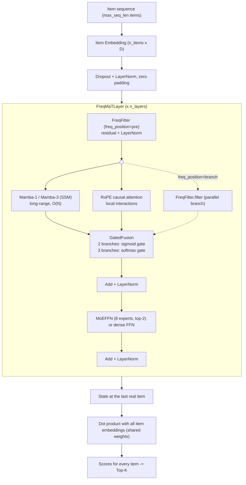

# FreqMaT architecture

## Options (`configs/model/freqmat.yaml`, validated by `FreqMaTConfig`)

| Option | Values | Meaning |
|---|---|---|
| `use_freq`, `freq_type` | `none`, `learned`, `bsa`, `both`, `gft` | FMLP-style filter / BSARec rescaler / cascade / time-weighted graph Fourier |
| `freq_position` | `pre`, `branch` | sequential denoiser vs. parallel branch fused by the gate |
| `use_mamba`, `mamba_type` | `mamba1`, `mamba3` | SSM branch; `mamba3` needs CUDA + `mamba-ssm` |
| `use_attn`, `attn_window` | `0` = full causal | attention branch |
| `ffn_type` | `moe`, `dense` | MoE replaces the FFN (param-matched by default) |
| `loss_type` | `CE`, `BPR` | BPR needs negative sampling configured |

## Source map

| Concept | File |
|---|---|
| Model (RecBole `SequentialRecommender`) | `src/freqmat/models/freqmat.py` |
| One layer | `src/freqmat/models/layer.py` |
| Hyper-parameters | `src/freqmat/models/config.py` |
| Frequency filter / graph basis | `models/modules/frequency.py`, `graph_fourier.py` |
| Mamba / attention / fusion / FFN+MoE | `models/modules/mamba.py`, `attention.py`, `fusion.py`, `ffn.py` |

Parameter counts depend on the dataset (embedding is `n_items x hidden_size`) and variant; read them from
`metrics.json` (`params`) of a run instead of this document.
