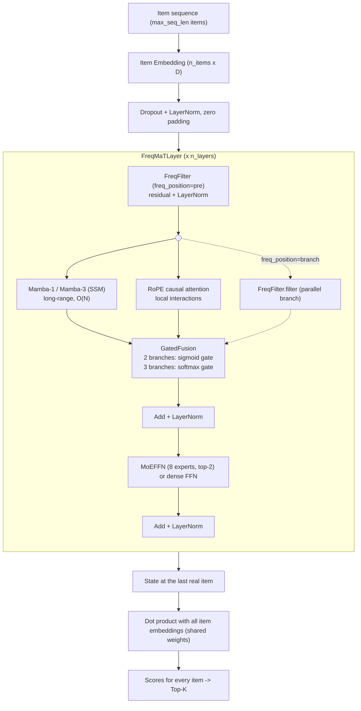

# FreqMaT architecture

## Options (`configs/model/freqmat.yaml`, validated by `FreqMaTConfig`)

Defaults: hidden 256, inner 1024, 2 layers (7.44M parameters on Beauty, 12K items, measured; 3 layers adds about 2M and 1 layer removes about 2M; the item embedding grows with the catalogue). All modules below are **on** by default: `freq_type: osc`, `use_local`, `mamba_flip`, `gate_granularity: branch`, `moe_shared`, `extrap`, `deep_sup_weight: 0.1`, `pop_debias`, `pop_align_weight: 0.05`, `pos_embedding`, pre-norm with RMSNorm, SwiGLU feed-forward, a final norm and a residual MLP output head (`norm_position: pre`, `norm_type: rmsnorm`, `ffn_act: swiglu`, `head_mlp`). Layer count: the models this one is compared with use 1 to 3 blocks (HSR best at 3, HoloMambaRec 2 to 3, SIGMA 1, HyMoERec 1) and each layer here holds four branches plus a MoE, so 2 layers; deep supervision needs at least 2. Set a switch off for its `w/o X` ablation. `mamba_flip` needs `use_mamba`; `deep_sup_weight` is ignored with `loss_type: BPR`.

| Option | Values | Meaning |
|---|---|---|
| `use_freq`, `freq_type` | `none`, `learned`, `bsa`, `both`, `gft`, `osc` | FMLP-style filter / BSARec rescaler / cascade / time-weighted graph Fourier / causal damped oscillator (`osc_hf`, `osc_beta_init`) |
| `freq_position` | `pre`, `branch` | sequential denoiser vs. parallel branch fused by the gate |
| `use_mamba`, `mamba_type` | `mamba1`, `mamba3` | SSM branch; `mamba3` needs CUDA + `mamba-ssm` |
| `use_attn`, `attn_window` | `0` = full causal | attention branch |
| `ffn_type` | `moe`, `dense` | MoE replaces the FFN (param-matched by default) |
| `use_local`, `local_kernel` | on | extra causal conv + GRU branch |
| `mamba_flip`, `flip_keep_last`, `flip_share_weights` | on, off | extra Mamba on the partially flipped sequence (flipped by true length) |
| `gate_granularity` | `channel`, `branch` | per-channel gate or one scalar per branch (far fewer parameters with 4+ branches) |
| `moe_shared`, `moe_shared_inner`, `moe_warmup_steps` | on (ramp 1000 steps) | always-on shared expert + routed experts, optional linear ramp of the routed part |
| `pos_embedding` | on | learned absolute position embedding added to the item embedding (SASRec-style) |
| `norm_position` | `pre` | `pre`: `x + f(norm(x))` with a final norm after the last layer; `post`: `norm(x + f(x))` |
| `norm_type` | `rmsnorm` | `rmsnorm` or `layernorm` |
| `ffn_act` | `swiglu` | `swiglu` (width 2/3, same parameter count) or `gelu`; applies to the shared expert and routed experts too |
| `head_mlp` | on | residual MLP `x + MLP(norm(x))` on the final state before it is scored against the item embeddings |
| `extrap` | on | one-step causal extrapolation of the final state |
| `deep_sup_weight` | `0.1` | weight of auxiliary CE on intermediate layers |
| `loss_scope` | `last` | `all`: every position predicts its next item (HoloMambaRec-style); needs `mamba_flip: false` and `freq_type` in {none, osc} |
| `pop_debias` | `true` | query minus learned λ·(popularity-weighted item centroid), λ = 0 at init (PDFlow-style); counts exclude each user's last two interactions |
| `pop_align_weight` | `0.05` | squared distance between head and tail item embeddings of one sequence (PDFlow alignment); `0` = off |
| `pop_head_frac` | `0.2` | share of items counted as head |
| `loss_type` | `CE`, `BPR` | BPR needs negative sampling configured |

## Source map

| Concept | File |
|---|---|
| Model (RecBole `SequentialRecommender`) | `src/freqmat/models/freqmat.py` |
| One layer | `src/freqmat/models/layer.py` |
| Hyper-parameters | `src/freqmat/models/config.py` |
| Frequency filter / graph basis | `models/modules/frequency.py`, `graph_fourier.py` |
| Mamba / attention / fusion / FFN+MoE | `models/modules/mamba.py`, `attention.py`, `fusion.py`, `ffn.py` |
| Oscillator filter / local GRU branch / flip | `models/modules/oscillator.py`, `local.py` |

Parameter counts depend on the dataset (embedding is `n_items x hidden_size`) and variant; read them from
`metrics.json` (`params`) of a run instead of this document.
